# quikleaf

[](LICENSE)
[](https://www.npmjs.com/package/quikleaf)
[](https://github.com/deftio/quikleaf/actions/workflows/ci.yml)


A standalone, cross-platform **local** markdown editor with rich rendering and LLM chat integration.

Built with [Tauri v2](https://tauri.app), rendered by [quikdown](https://github.com/deftio/quikdown), with a UI built from [bitwrench.js](https://github.com/deftio/bitwrench) TACO objects.



## Features

- **Rich Markdown Rendering** — Powered by [quikdown](https://github.com/deftio/quikdown) standalone bundle with support for syntax highlighting, Mermaid diagrams, Math/LaTeX, GeoJSON maps, 3D STL viewer, CSV/TSV tables, Vega/Vega-Lite charts, ABC music notation, SVG, and more — all rendered locally without external services.

- **LLM Chat Integration** — Built-in AI assistant (QD) with streaming responses, 26 tools (document, tabs, plan, memory, key-value, project files, project search), slash commands, and a tool-calling loop with a stop button. Supports OpenAI-compatible APIs (Ollama, LM Studio, Docker Model Runner, OpenRouter, Groq) and Anthropic Claude. Auto-detects local servers.

- **Edits you can review** — QD's document and file edits show up as diff cards in the chat. Choose in Settings → Agent whether to review every edit, only project file writes (default), or none; reviewed edits wait for Accept or Reject, the rest apply and show the diff. For multi-step work QD keeps a plan card up to date.

- **Writing tools** — Outline panel (Cmd/Ctrl+Shift+O) with click-to-jump, find and replace with match case and regex (Cmd/Ctrl+F, Cmd/Ctrl+H), live word count and reading time in the status bar, focus mode (Cmd/Ctrl+Shift+D), Export HTML and Print / PDF in the File menu.

- **Tabs** — Several documents open at once with a tab bar, dirty indicators, unsaved-changes prompts, Cmd/Ctrl+N / W and Ctrl+Tab cycling. The file tree follows the active tab and QD can list, switch and open tabs.

- **Project Mode** — Open a folder with `--project ./dir` to get a file tree sidebar, project-scoped file tools, persistent memory/KV store, and project state saving.

- **Native Desktop App** — Fast startup, low memory, native file dialogs, CLI support, keyboard shortcuts, auto dark mode, resizable panels. Cross-platform: macOS, Windows, Linux.

- **Timing you can see** — Every message carries a timestamp; replies show time-to-first-token, total time, approximate tokens and tok/s. Tool calls show their duration. Both toggles update the chat instantly from Settings, and the same numbers go to a JSON-lines performance log you can turn off.

- **bitwrench UI** — The whole shell (title bar, panels, dialogs, theme) is generated at runtime by [bitwrench.js](https://github.com/deftio/bitwrench): UI as plain objects, CSS generated from two seed palettes (light and dark), no hand-written HTML.

## Quick Start

Four ways to get quikleaf, pick one:

| Option | Command / where | Best for |
|--------|-----------------|----------|
| Pre-built installer | [Releases](https://github.com/deftio/quikleaf/releases): `.dmg`, `.msi`/`.exe`, `.deb`/`.AppImage` | Most people |
| npm launcher | `npm install -g quikleaf` or `npx quikleaf file.md` | Node users, scripts, CI |
| Build from source | `npm install && npm run setup && npm run tauri:build` | Contributors |
| Command line from the macOS app | Help → Install Command Line Tool | After a drag-and-drop install |

### Pre-built installers (recommended)

Download from the [Releases](https://github.com/deftio/quikleaf/releases) page.
Installers and npm binaries are published automatically for every tagged
release from v1.1.0 on (earlier tags shipped no assets because of a CI
trigger bug, see [CHANGELOG](CHANGELOG.md)).

| Platform | Format |
|----------|--------|
| macOS (Apple Silicon) | `.dmg` |
| macOS (Intel) | `.dmg` |
| Windows | `.msi` / `.exe` |
| Linux | `.deb` / `.AppImage` |

### Install via npm

```bash
npm install -g quikleaf      # or: npx quikleaf document.md
quikleaf document.md
```

The npm package is a thin launcher: it pulls the platform binary from
`@deftio/quikleaf-<platform>` (or downloads it from the GitHub release) and
runs it. Requires Node.js 18+.

### Build from source

```bash
git clone https://github.com/deftio/quikleaf.git && cd quikleaf
npm install && npm run setup && npm run tauri:build
```

`npm run setup` checks for required system dependencies (Node.js, Rust,
platform libraries) and prints install commands for your platform.
The built app and installers are in `src-tauri/target/release/bundle/`.

## Usage

### Simple Mode (single file)

```bash
quikleaf                    # Open empty editor
quikleaf document.md        # Open a file
```

### Project Mode (folder)

```bash
quikleaf --project ./mydir  # Open folder with file tree and project tools
```

Project mode enables:
- File tree sidebar
- File read/write/list/stat tools for the LLM
- Persistent memory and key-value store
- Project state saved to `quikleaf.prj`

### Keyboard Shortcuts

| Shortcut | Action |
|----------|--------|
| `Cmd/Ctrl + N` | New document (tab) |
| `Cmd/Ctrl + O` | Open file |
| `Cmd/Ctrl + S` | Save file |
| `Cmd/Ctrl + W` | Close tab (prompts if unsaved) |
| `Ctrl + Tab` / `Ctrl + Shift + Tab` | Next / previous tab (`Cmd + Shift + ]` / `[` on macOS) |
| `Cmd/Ctrl + F` | Find (Enter next, Shift+Enter previous, Esc close) |
| `Cmd/Ctrl + H` | Find and replace (use View → Find & Replace on macOS, where Cmd+H hides the app) |
| `Cmd/Ctrl + Shift + O` | Toggle outline panel |
| `Cmd/Ctrl + Shift + D` | Focus mode (Esc exits) |
| `Cmd/Ctrl + P` | Print / save as PDF |
| `Enter` (in chat) | Send message |
| `Shift + Enter` (in chat) | New line |

### Chat Slash Commands

| Command | Description |
|---------|-------------|
| `/help` | Show available commands |
| `/clear` | Clear chat history |
| `/model` | Show current LLM model |
| `/memory` | Show scratchpad contents |
| `/tools` | List available tools |
| `/log` | Show the performance log location and recent timings |

## LLM Configuration

Click **Settings** in the title bar and pick a preset (Ollama, LM Studio, Docker Model Runner, OpenRouter, Anthropic), or let quikleaf auto-detect a local Ollama, LM Studio or Docker Model Runner instance on first launch.

### Example Configurations

**Local Ollama:**
```
Provider: OpenAI-compatible
Host: http://localhost:11434/v1
API Key: (leave blank)
Model: llama3.2
```

**Docker Model Runner:**
```
Provider: OpenAI-compatible
Host: http://localhost:12434/engines/v1
API Key: (leave blank)
Model: ai/smollm2
```
Enable host access once with `docker desktop enable model-runner --tcp 12434`, then `docker model pull ai/<model>`.

**Anthropic Claude:**
```
Provider: Anthropic
Host: https://api.anthropic.com
API Key: sk-ant-...
Model: claude-sonnet-5-5
```

**OpenRouter:**
```
Provider: OpenAI-compatible
Host: https://openrouter.ai/api/v1
API Key: sk-or-v1-...
Model: meta-llama/llama-3.1-70b-instruct
```

## Timestamps and the performance log

Settings → **Chat display** toggles timestamps/timings and tool-call entries; both apply to messages already on screen. Settings → **Diagnostics** toggles the performance log. When on, quikleaf appends one JSON object per LLM request (`kind: "llm"`: `ttft_ms`, `total_ms`, `est_tokens`, `tok_per_s`, model, host), per tool call (`kind: "tool"`: name, `ms`) and per chat turn to:

| Platform | File |
|----------|------|
| macOS | `~/Library/Logs/com.deftio.quikleaf/quikleaf-perf.jsonl` |
| Linux | `~/.local/share/com.deftio.quikleaf/logs/quikleaf-perf.jsonl` |
| Windows | `%LOCALAPPDATA%\com.deftio.quikleaf\logs\quikleaf-perf.jsonl` |

`/log` in the chat and **About → Diagnostics** show the path and the latest entries; "Open Log Folder" and "Clear Log" are in Settings. Nothing is written while the toggle is off.

## Command line from the macOS app

Dragging `quikleaf.app` into Applications does not put `quikleaf` on your PATH. Use **Help → Install Command Line Tool** (also in About → Diagnostics): it writes a tiny shim to `/usr/local/bin`, `/opt/homebrew/bin` or `~/.local/bin`, whichever is writable, and tells you if that directory still needs adding to PATH. Then:

```bash
quikleaf notes.md &            # & returns you to the prompt
quikleaf --project ./docs &
```

Re-run the menu item after moving the app. The npm package (`npm install -g quikleaf`) installs its own launcher and does not need this.

## Building from Source

### Prerequisites

- **Node.js** 18+ and npm (Node 22 is what CI uses)
- **Rust** stable 1.77+ ([rustup.rs](https://rustup.rs)); Tauri 2.12 needs a current toolchain
- Platform-specific dependencies (see below)

**macOS:**
```bash
xcode-select --install
```

**Linux (Debian/Ubuntu):**
```bash
sudo apt install -y libwebkit2gtk-4.1-dev build-essential curl wget file \
  libxdo-dev libssl-dev libayatana-appindicator3-dev librsvg2-dev
```

**Windows:**
- Visual Studio 2022 with "Desktop development with C++" workload

### Build Commands

```bash
npm install                 # Install frontend deps
npm run dev                 # Vite dev server (frontend only)
npm run tauri:dev           # Full dev mode with hot reload
npm run tauri:build         # Production build with installer
npm run check               # TypeScript type checking
npm test                    # Unit tests (vitest, 300+)
npm run test:coverage       # Unit tests + coverage gate (≥90% lines/statements/functions, ≥85% branches)
npm run test:e2e            # End-to-end tests (Playwright, 64)
cd src-tauri && cargo test  # Rust tests (100+)
```

### Releasing

Maintainers only. `npm run feature -- "name" [minor|major]` starts a branch and bumps every version file; `npm run release:dry` runs all gates (types, unit tests with the coverage gate, e2e, cargo check/test, version sync) without pushing; `npm run release` runs them and opens the PR whose merge triggers CI to tag and publish installers and npm packages.

### Build Output

- **macOS**: `src-tauri/target/release/bundle/dmg/`
- **Windows**: `src-tauri/target/release/bundle/nsis/`
- **Linux**: `src-tauri/target/release/bundle/deb/`, `appimage/`

## Architecture

```
src-tauri/              Rust backend (Tauri v2)
  src/commands/
    fs.rs               File I/O commands
    llm.rs              LLM API proxy with streaming
    project.rs          Project state, memory, KV, file tools
    diag.rs             Performance log (JSON lines) + CLI shim installer
  src/main.rs           CLI parsing, app setup, asset protocol
  src/lib.rs            Library entry point (mirrors main.rs)

src/                    TypeScript frontend (Vite + bitwrench)
  ui/theme.ts           Light + dark bitwrench themes, app CSS via bw.css()
  ui/shell.ts           Title bar, menus, status bar (TACO)
  ui/about.ts           About dialog (bw.makeModal)
  ui/taco.ts            TACO helpers (withAttrs, typed makeModal)
  ui/toast.ts           Notifications (bw.makeToast)
  ui/tabbar.ts          Editor tab bar
  ui/outline.ts         Outline side panel
  ui/findbar.ts         Find & replace bar
  ui/focus.ts           Focus mode
  ui/stats.ts           Word count / reading time in the status bar
  diag/perf.ts          Timing math, formatting, performance-log client
  editor/editor.ts      quikdown editor wrapper
  editor/tabs.ts        Pure tab model (bw.pub "tabs:changed")
  editor/documents.ts   Session controller: tabs ↔ editor, open/save/close, shortcuts
  editor/find.ts        Match / replace logic
  editor/outline.ts     Heading parser
  editor/stats.ts       Word, char, line, reading-time stats
  editor/export.ts      Standalone HTML export and print
  chat/chat-ui.ts       Chat panel TACO, tool dispatch, slash commands
  chat/chat-utils.ts    Tool schemas and system prompt
  chat/review.ts        Diff review cards (Accept / Reject)
  chat/plan.ts          Plan card
  chat/diff.ts          Line diff
  chat/providers.ts     LLM provider adapters (OpenAI, Anthropic)
  settings/settings.ts  Settings dialog (bitwrench form), presets, auto-detect
  project/file-tree.ts  Project mode file tree sidebar
  main.ts               Mounts the shell, wires modules, project mode

index.html              Empty <div id="app"> — everything is mounted by bitwrench
```

### Key Design Decisions

- LLM operates on raw markdown only — never sees or produces HTML
- LLM API calls proxied through Rust backend to avoid CORS and protect API keys
- quikdown standalone bundle includes all fence renderers (~8MB) for offline use
- UI is data: every element is a bitwrench TACO object, styles are generated from seed colors, dark mode is a second scoped theme toggled with one class
- Tool-calling loop with 60s timeout per call and user-accessible stop button

## Troubleshooting

**macOS: "quikleaf is damaged and can't be opened"**
```bash
xattr -cr /Applications/quikleaf.app
```

**LLM not responding:** Check endpoint is reachable, API key is correct, and model name matches. For Ollama, ensure `ollama serve` is running.

**Tool calls hanging:** Click the red "Stop" button, or try a different model. Some smaller models don't handle tool calling well.

## License

BSD 2-Clause License. Copyright (c) 2026 deftio.

See [LICENSE](LICENSE) for details.

## Links

- [quikleaf on GitHub](https://github.com/deftio/quikleaf)
- [quikdown on GitHub](https://github.com/deftio/quikdown)
- [Issues](https://github.com/deftio/quikleaf/issues)
- [Full Specification](dev/quikleaf-spec.md) 


